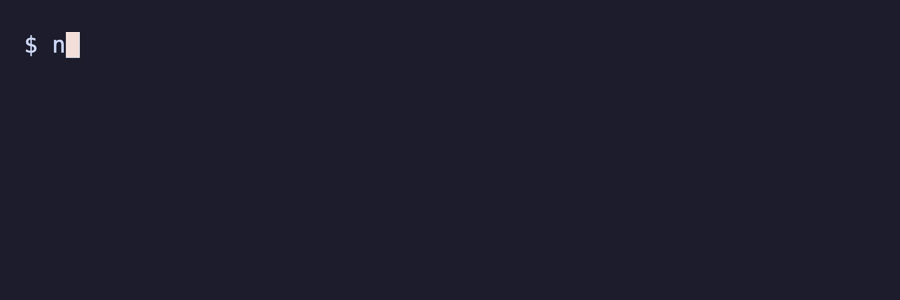

# buddy-back

A little company for the long coding sessions: an ASCII buddy that reacts to Claude Code as you work.

[](https://github.com/itzjk/buddy-back/actions/workflows/test.yml)
[](LICENSE)



## Quick start

Requires Node.js 20+ on macOS, Linux, or WSL. Install and set up your buddy:

```sh
npm i -g github:itzjk/buddy-back && buddy-back install
```

Restart Claude Code to load the hooks. Meet your buddy in a terminal preview:

```sh
buddy-back demo --animate
```

Press Ctrl-C to finish the preview. Your buddy lives in Claude Code's status line during normal sessions. No feeding schedule required.

## Features

- Pick a cat, robot, ghost, or dragon and give it a name.
- See thinking, passing tests, tool failures, and naps at a glance.
- Get a little celebration when a turn takes at least a minute.
- Keep your existing status command and hooks, with a backup before setup.
- Turn your buddy off persistently, then bring it back with the same name.
- Spend zero tokens: local files, no network calls, no runtime dependencies.

## Why

The community's [“Bring Back Buddy” request](https://github.com/anthropics/claude-code/issues/45596) had **1,195 thumbs-up reactions on October 27, 2026**. It reports that `/buddy` disappeared in v2.1.97 and asks for customization, session reactions, and a persistent off switch. buddy-back gives that empty corner of your terminal a new resident.

This is a community project, with no affiliation with or endorsement from Anthropic. The ASCII companions are original; saved pets from the former `/buddy` feature aren't imported.

## How it works

Installation merges a [command status line](https://code.claude.com/docs/en/statusline) and session hooks into `~/.claude/settings.json`. Hooks record activity locally; the status command reads it and prints an animated frame once per second. Your previous command status line appears above the buddy. Sessions stay separate, and prompts, tool output, and transcripts aren't saved. The GIF replays sample hook events through these installed commands in a temporary profile; see the [recording instructions](docs/development.md#record-the-demo).

## Usage

| Command | What happens |
| --- | --- |
| `buddy-back list` | Meet all four companions |
| `buddy-back choose dragon` | Switch companions |
| `buddy-back name Ember` | Set a name, up to 24 printable ASCII characters |
| `buddy-back demo` | Print every reaction |
| `buddy-back demo --animate` | Watch an animated preview |
| `buddy-back off` / `buddy-back on` | Hide or restore your buddy across restarts |
| `buddy-back install` | Configure the status line and hooks |
| `buddy-back uninstall` | Remove the integration and restore settings |
| `buddy-back help` | Show all commands |

## FAQ

**Will this replace my status line?**

Your existing command still runs with the same input, and its output appears above the buddy. Existing hooks remain installed.

**Can I undo installation?**

Run `buddy-back uninstall` before `npm uninstall -g buddy-back`. With no intervening settings edits, uninstall restores the original bytes and permissions. Otherwise, it removes its own integration while preserving your later edits. Backups and preferences remain. [Configuration and recovery](docs/configuration.md) covers profiles and manual recovery.

**Does it know my tests passed?**

It recognizes common test commands and requires a success summary or explicit zero exit code. Failure evidence takes priority. Unrecognized output may leave it thinking.

**Can another terminal agent use it?**

Yes, if it supports a command status line and activity events. You supply the wiring; the [adapter example](docs/configuration.md#other-terminal-agents) shows the JSON interface.

## Limitations

- Terminal status line only; no VS Code panel. Native Windows users need WSL.
- Older Claude Code versions may refresh only on events. Project or managed settings can override the integration.
- Claude Code hides the status line during permission prompts, so the waiting expression may be hidden too.
- Reactions depend on delivered hooks and recognizable output. They describe activity, not code quality.
- Automated tests cover installed commands with fixture JSON. An interactive Claude Code session still needs a manual check.

## Contributing

Run `npm test` from a clone; [development instructions](docs/development.md) cover the benchmark and demo recording. CI tests Node 20, 22, and 24 on Linux and macOS.

## License

[MIT](LICENSE).
